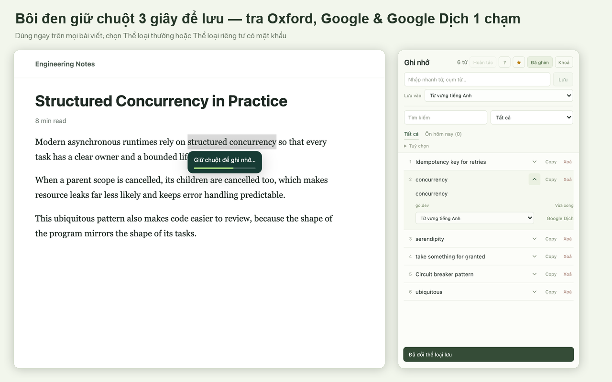

  
  <h1>Memorizes — Ghi nhớ nhanh &amp; Ôn tập cách quãng</h1>
  
Tiện ích Chrome miễn phí, phi lợi nhuận giúp lưu nhanh từ vựng, cụm từ và kiến thức ngay lúc đọc web.

  

    <a href="#hướng-dẫn-4-bước"><strong>Hướng dẫn 4 bước</strong></a> •
    <a href="#chrome-web-store"><strong>Chrome Web Store</strong></a> •
    <a href="https://github.com/JustineUIT/memorizes-community/issues/new?template=review.yml&labels=review"><strong>Đánh giá &amp; Đề xuất ★</strong></a> •
    <a href="https://github.com/JustineUIT/memorizes-community/issues/new?labels=bug&title=%5BB%C3%A1o%20l%E1%BB%97i%5D%20"><strong>Báo lỗi</strong></a> •
    <a href="PRIVACY_POLICY.md"><strong>Quyền riêng tư &amp; Miễn trừ</strong></a>
  

---

## Tính năng chính
- **Lưu siêu tốc 2 cách:** Bôi đen giữ chuột trái **3 giây** trên web hoặc nhập trực tiếp ở bảng bên (tự gắn link bài đang xem).
- **2 chế độ linh hoạt:** **Nhóm thường** dùng ngay không cần mật khẩu; tuỳ chọn tạo **Nhóm riêng tư (`🔒`)** có mật khẩu riêng *(không đặt tên nhóm nhạy cảm vì tên vẫn hiện trong menu)*.
- **Tra nghĩa 1 chạm & Ôn tập:** Bấm vào từ để mở **Oxford** / **Google Tìm kiếm**; mở **`▾`** để dùng **Google Dịch**; tab **Ôn hôm nay** hỗ trợ **Nhớ / Quên** và nhắc nhẹ định kỳ.

  

## Hướng dẫn 4 bước
1. Bấm icon Memorizes trên thanh Chrome → đọc tóm tắt dữ liệu, tích **Đồng ý** và bấm **Bắt đầu sử dụng**.
2. Trên web, bôi đen chữ và **giữ nguyên chuột trái 3 giây** để lưu (tải lại trang một lần nếu mở từ trước lúc cài), hoặc nhập vào ô **Nhập nhanh**.
3. Bấm vào từ để tra nghĩa, mở **`▾`** để dùng Google Dịch, hoặc tạo **Nhóm riêng tư (`🔒`)** nếu muốn đặt mật khẩu cho nhóm đó.
4. Vào **Ôn hôm nay** ôn lại mỗi ngày, và nên vào **Tuỳ chọn → Xuất sao lưu** (`.memorizes`) định kỳ.

## Chrome Web Store
Cài đặt chính thức và duy nhất tại **Chrome Web Store** (liên kết sẽ được gắn tại đây ngay sau khi duyệt). Không cài đặt từ bất kỳ tệp hay nguồn nào khác ngoài Chrome Web Store.

## Không máy chủ & Miễn trừ trách nhiệm
- **Không máy chủ (Zero-Server):** Nhà phát triển không có máy chủ, không thu thập và không lưu bất kỳ dữ liệu hay mật khẩu nào của bạn. Toàn bộ dữ liệu chỉ nằm trên trình duyệt của bạn và chỉ rời máy khi chính bạn bấm tra từ hoặc gửi góp ý.
- **Không chạm mật khẩu web:** Tiện ích không đọc ô điền mật khẩu, biểu mẫu web hay cookies.
- **Miễn trừ trách nhiệm ("AS IS"):** Không khôi phục được mật khẩu nhóm riêng tư nếu bạn quên hoặc mất dữ liệu khi không sao lưu; nghiêm cấm lưu mật khẩu tài khoản, mã OTP, ví tiền số, thẻ ngân hàng vào tiện ích; miễn trừ mọi trách nhiệm với sự cố thiết bị cá nhân (virus, keylogger, lừa đảo).

## Góp ý, Báo lỗi & Đề xuất tính năng
- [**Gửi đánh giá hoặc đề xuất tính năng ★**](https://github.com/JustineUIT/memorizes-community/issues/new?template=review.yml&labels=review)
- [**Báo lỗi cần khắc phục**](https://github.com/JustineUIT/memorizes-community/issues/new?labels=bug&title=%5BB%C3%A1o%20l%E1%BB%97i%5D%20)
- [**Xem toàn bộ phản hồi cộng đồng**](https://github.com/JustineUIT/memorizes-community/issues) • [**Chính sách quyền riêng tư & Miễn trừ**](PRIVACY_POLICY.md)
